<div align="center">



<a href="https://git.io/typing-svg"></a>

<p>
  <a href="https://www.linkedin.com/in/phanurut-kd/"></a>
  <a href="https://bento.me/kdhiroki"></a>
  <a href="https://github.com/kondohiroki"></a>
  
</p>

</div>

---

### 🧬 `whoami`

```yaml
name:      Ki (Phanurut Kondo)
based_in:  Bangkok, Thailand 🇹🇭
work:      Bluebik Group PLC. · Orbit Digital
focus:     AI-Native SDLC — agentic coding, end to end
stack:     [Go, TypeScript, Cloudflare Workers, React]
belief:    "The agent writes the code. The human owns the intent and the bar."
```

### 🔁 How I ship



### ⌨️ A day in the terminal



### 🛠️ Tech stack

<p align="center">
  <a href="https://skillicons.dev"></a>
</p>

### 📈 Activity

<p align="center">
  
</p>

<div align="center">

<sub>Built with agents, reviewed by a human. ✦</sub>

</div>
